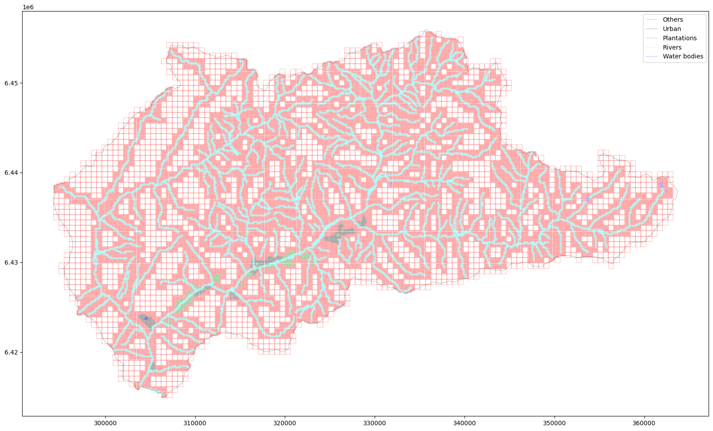
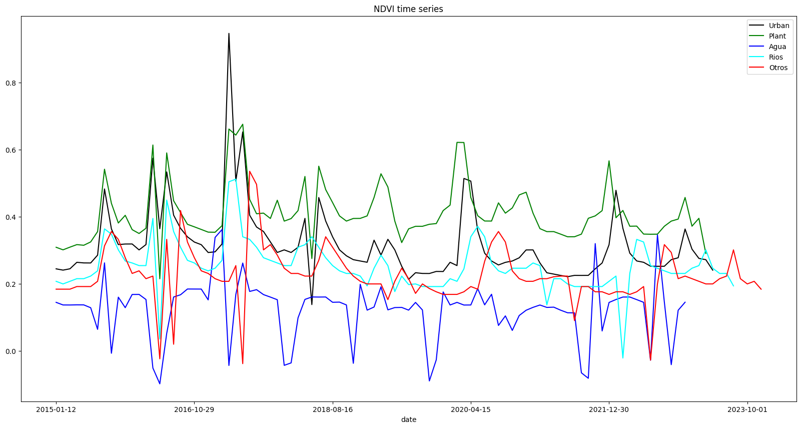

[English](README.md) | [Español](README.es.md)

# Water Scarcity in Petorca — Satellite-Based Drought Monitoring

Team project (2024) studying **drought and water scarcity in Petorca**, a commune in
Chile's Valparaíso Region known for its water crisis and its avocado plantations. It uses
Sentinel-2 and Landsat-8 imagery, accessed through **Google Earth Engine**, to:

1. split the commune into a fine grid and classify each cell by land use;
2. compute vegetation and drought indices (NDVI, NDWI, NMDI, PDSI) for each land-use class
   over time;
3. analyse the resulting time series for trends and forecasting.

<p align="center">
  
  
</p>

## Pipeline

### 1. Land-use grid — [`test_image_splitting.ipynb`](test_image_splitting.ipynb)
The commune's boundary (Library of Congress of Chile), CIREN's avocado-plantation
polygons, the hydrography and the urban zones are combined to split Petorca into a grid.
Each cell is labelled as **urban**, **plantation**, **river**, **water body** or **other**
([`image_manipulation.py`](image_manipulation.py)). The grid is used both to extract
training images and to aggregate indices per land-use class.

### 2. Drought indices — [`indexes.ipynb`](indexes.ipynb), [`time_series.py`](time_series.py), [`PDSI.ipynb`](PDSI.ipynb)
- `indexes.ipynb` documents the formulas of each index for Sentinel-2 and Landsat-8,
  with references.
- `time_series.py` computes the median NDVI / NDWI / NMDI of each land-use class on
  monthly Landsat-8 images (2015–2023) and exports the series to
  `Data/Petorca_*_time_series.xlsx`.
- `PDSI.ipynb` uses TerraClimate data to analyse the Palmer Drought Severity Index
  together with potential and actual evapotranspiration (PET, AET) and runoff (RO).

### 3. Land-use classification — [`ResNETClassification/`](ResNETClassification), [`model_train.ipynb`](model_train.ipynb)
- A **ResNet-50** is fine-tuned on the [EuroSAT](https://github.com/phelber/EuroSAT)
  dataset (`OE1_fineTuneModels.ipynb`, Google Colab). It is then used to classify
  Sentinel-2 tiles of Petorca from 2018 to 2023 (`OE2_ClasificacionLULC_S2.ipynb`), which
  makes it possible to follow changes in land use over time.
- As a lighter baseline, `model_train.ipynb` trains Random Forest and SVM classifiers on
  hand-labelled Petorca patches (`Data/PetorcaSAT/`: built, crop, grass, water), using
  SMOTE-Tomek rebalancing.
- [`segment.py`](segment.py) provides SNIC superpixel segmentation and vectorisation
  through Earth Engine.

### 4. Time-series analysis — [`time_series_analysis/`](time_series_analysis)
R scripts, one per land-use class, fit a harmonic regression (seasonality), a linear trend
and ARIMA models to the NDVI series in order to quantify the trend and forecast drought
levels. [`Time_Series.R`](Time_Series.R) is the same analysis applied to the whole commune.

## `gee_objects.py` — Earth Engine helper module

A small wrapper that simplifies extracting imagery and index values from Google Earth
Engine for any region given as a GeoPandas geometry. Satellite-specific settings (bands,
scale factors, cloud masks) are in [`sat_params.py`](sat_params.py).

```python
import ee, geopandas as gpd
import gee_objects as gee

ee.Initialize()
geometry = gpd.read_file('Data/petorca.json').geometry
petorca = gee.GEERegion(geometry, name='Petorca', crs='EPSG:4326')

images = petorca.get_images('2023-01-01', '2023-12-31', satt='Sentinel-2', dayfreq=15)
ndvi   = petorca.get_indexes('NDVI', images=images)
petorca.visualize(ndvi)
```

### `GEERegion(geometry, name='GEERegion', crs=None)`
The study region. It takes a `gpd.GeoSeries`; if `crs` is given, the geometry is
reprojected to it.

| Method | Description |
|---|---|
| `get_image(start_date, end_date, satt='Sentinel-2', clip=False)` | Least-cloudy image of the region between two dates. With `clip=False` the image covers the region's bounding envelope; with `clip=True` it is cut to the exact geometry. |
| `get_images(start_date, end_date, satt='Sentinel-2', dayfreq=15, clip=False)` | One image every `dayfreq` days between the two dates. |
| `get_indexes(index_name, images=None, start_date=None, end_date=None, satt='Sentinel-2', dayfreq=15, clip=False, add_bands=False)` | Computes an index for a list of images, or fetches the images first if dates are given. Supported: **NDVI**, **NDWI**, **NMDI**, and NDDI (experimental). With `add_bands=True` the index is added as a band of the original images. |
| `visualize(images, zoom=10, clip=False)` | Displays the images on an interactive `geemap` map. |

### `GEEImage(image, satt, date, imgtype='all')`
A wrapper around `ee.Image` that keeps track of the satellite, the acquisition date and
the image type (`all` for the full set of bands, or the name of an index).

| Method | Description |
|---|---|
| `clip(geometry)` | Clips the image to an `ee.Geometry`. |
| `save(path='file.tif', format='GEO_TIFF', bands=None)` | Saves the image as a GeoTIFF, or returns the band values as a `numpy` array. |

## Repository structure

```
gee_objects.py, sat_params.py   # Earth Engine wrapper and satellite parameters
image_manipulation.py           # Grid creation and image splitting
segment.py                      # SNIC segmentation
time_series.py                  # Index time-series extraction per land-use class
*.ipynb                         # Analysis notebooks (see Pipeline)
ResNETClassification/           # ResNet-50 LULC models, notebooks and predictions
time_series_analysis/           # R time-series models per land-use class
auxiliars/                      # Folium/Earth Engine plotting helper
Data/                           # Boundaries, grids, labelled patches and exported series
```

## Requirements

- Python 3.10+ with `earthengine-api`, `geemap`, `geopandas`, `pandas`, `numpy`,
  `matplotlib`, `tqdm` and `scikit-learn`; `torch` / `torchvision` for the ResNet notebooks.
- A Google Earth Engine account (`earthengine authenticate`).
- R with `forecast` and `TTR` for the time-series scripts.
